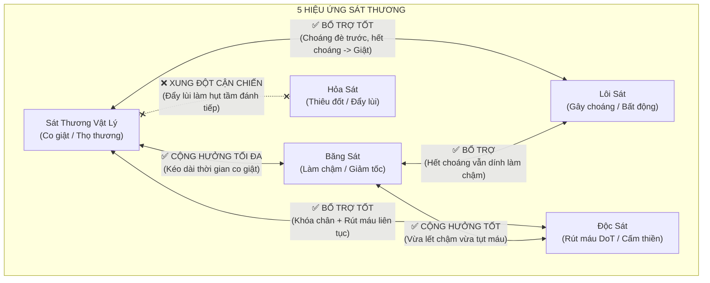

# Cẩm Nang: Tương Tác & Kết Hợp 5 Loại Hiệu Ứng Sát Thương (Võ Lâm Truyền Kỳ)

> **Mục đích tài liệu**: Tài liệu độc lập hướng dẫn chi tiết mối quan hệ giữa **5 loại sát thương** (Vật lý, Băng sát, Lôi sát, Độc sát, Hỏa sát), phân tích rõ **hiệu ứng nào có thể kết hợp (cộng hưởng)** và **hiệu ứng nào xung đột (triệt tiêu)** trong cơ chế PK của game.

---

## 1. Bảng Tổng Quan 5 Loại Sát Thương & Hiệu Ứng

| Loại Sát Thương | Hệ Ngũ Hành | Hiệu Ứng Trạng Thái Đi Kèm | Bản Chất Cơ Học Trong Game |
| :--- | :---: | :--- | :--- |
| **Sát Thương Vật Lý** | Trung tính / Kim | **Co giật / Thọ thương (`HurtFrame`)** | Khiến đối thủ bị nảy giật về sau, khựng chuyển động trong $12\text{ frames}$ ($0.67\text{s}$). |
| **Băng Sát** | Thủy | **Làm chậm (`Freeze / Slow`)** | Giảm $30\% - 60\%$ tốc độ chạy và kéo dài thời gian hoạt ảnh ra chiêu/co giật. |
| **Lôi Sát** | Thổ | **Gây choáng (`Stun`)** | Khống chế cứng tuyệt đối, đối phương bất động hoàn toàn trên đầu có vòng xoay. |
| **Độc Sát** | Mộc | **Rút máu theo chu kỳ (`Poison DoT`)** | Rút máu đều đặn từng đợt ticks, cấm bấm phím `V` ngồi thiền nghỉ ngơi. |
| **Hỏa Sát** | Hỏa | **Thiêu đốt / Đẩy lùi (`Knockback`)** | Sát thương bộc phát tức thời cực mạnh, một số chiêu thức hất văng mục tiêu lùi lại. |

---

## 2. Sơ Đồ Ma Trận Tương Tác & Kết Hợp

---

## 3. Các Cặp Hiệu Ứng CÓ THỂ KẾT HỢP (Cộng Hưởng Cực Mạnh)

### 3.1 Vật Lý (Co Giật) + Băng Sát (Làm Chậm) — *Combo Ác Mộng Số 1*
- **Cơ chế**: Băng sát làm chậm tốc độ khung hình hoạt ảnh của mục tiêu ($Slow$). Khi mục tiêu đang bị làm chậm mà nhận tiếp đòn sát thương vật lý, hoạt ảnh co giật `HurtFrame` $12\text{ frames}$ ($0.67\text{s}$) thông thường sẽ **bị kéo dài lê thê thành $16 - 20\text{ frames}$ ($> 1\text{ giây}$)**!
- **Thực chiến**: Đối phương gần như bị **"đóng băng đứng hình tại chỗ"**, không thể nhấc chân bước đi dù chỉ 1 pixel.
- **Ứng dụng**: Đây là lý do vì sao vũ khí có dòng **Băng Sát Ngoại Công ($+60 \sim 100$)** luôn là trang bị đắt giá nhất của các phái cận chiến (Thiên Vương, Thiếu Lâm Đao, Thúy Yên Đao).

### 3.2 Vật Lý (Co Giật) + Lôi Sát (Gây Choáng) — *Khống Chế Nối Tiếp*
- **Cơ chế**: Gây choáng ($Stun$) là trạng thái khống chế cấp cao nhất (Hard CC), tạm thời ghi đè lên co giật.
- **Thực chiến**: Khi mục tiêu vừa hết thời gian bị choáng, đòn vật lý tiếp theo lập tức kích hoạt co giật, tạo thành chuỗi khống chế nối tiếp liên hoàn khiến mục tiêu không thể xuất chiêu phản kháng.

### 3.3 Vật Lý (Co Giật) + Độc Sát (DoT) — *Bào Máu & Cấm Thiền*
- **Cơ chế**: Sát thương vật lý giữ chân đối thủ bằng co giật, trong khi Độc sát rút máu đều đặn từng tick và **cấm đối thủ bấm phím `V` ngồi thiền hồi máu**.

### 3.4 Băng Sát (Làm Chậm) + Độc Sát (DoT) — *Rút Máu Di Động*
- **Cơ chế**: Mục tiêu vừa bị giảm tốc độ di chuyển lê lết, vừa bị độc ngấm vào người rút máu liên tục mà không có cơ hội dừng lại để phục hồi.

---

## 4. Các Cặp Hiệu Ứng KHÔNG Thể Kết Hợp / Xung Đột Nguy Hiểm

### 4.1 Vật Lý Cận Chiến + Hỏa Sát (Đẩy Lùi) — *Tự Bóp Nghẹt Tầm Đánh*
- **Cơ chế**: Hiệu ứng Hỏa sát của một số phái (như Cái Bang Bổng, Thiên Nhẫn) có thuộc tính **Đẩy lùi (Knockback)**.
- **Tác hại**: Khi một phái cận chiến (như Thiên Vương, Thiếu Lâm Côn) chém trúng, đối phương bị **văng nảy ra xa $1 - 2$ bước chân**, khiến **nhát chém/đâm tiếp theo của bạn bị hụt tầm (Miss tầm đánh)** và ngắt mất chuỗi combo!
- 👉 **Quy tắc vàng**: Các phái cận chiến **TUYỆT ĐỐI TRÁNH Hỏa sát đẩy lùi** trên vũ khí.

### 4.2 Độc Sát KHÔNG Thể Tự Kích Hoạt Co Giật
- Độc sát là sát thương rút máu theo thời gian (Damage over Time - DoT). Các đợt máu tụt do độc **hoàn toàn không tạo ra hoạt ảnh giật lùi (`HurtFrame`)**.
- Muốn đối phương bị giật, bắt buộc phải có sát thương vật lý trực tiếp đánh trúng đích.

### 4.3 Kỹ Năng Nội Công KHÔNG Nhận Dòng Nguyên Tố Trên Vũ Khí
- Nếu nhân vật sử dụng chiêu thức Nội công (Cái Bang Rồng, Võ Đang Khí, Nga My Chưởng), các dòng Băng sát, Lôi sát, Độc sát ép trên vũ khí **hoàn toàn vô tác dụng**; chiêu thức chỉ mang loại sát thương nguyên tố gốc của chính kỹ năng đó.

---

## 5. Bảng Tra Cứu Nhanh Cho Từng Môn Phái (Cheat Sheet)

| Phái / Hệ | Loại Sát Thương Chính | Combo Hiệu Ứng Ưu Tiên | Thuộc Tính Cần Tránh Trên Vũ Khí |
| :--- | :--- | :--- | :--- |
| **Thiên Vương (Thương / Chùy / Đao)** | Vật lý cận chiến | **Vật lý + Băng sát + Choáng** *(Giật đứng hình + Choáng)* | ❌ **Tránh Hỏa sát đẩy lùi** |
| **Thiếu Lâm (Côn / Đao)** | Vật lý cận chiến | **Vật lý + Băng sát + Phản đòn** | ❌ **Tránh Hỏa sát đẩy lùi** |
| **Đường Môn (Phi Đao / Nỏ)** | Vật lý tầm xa | **Vật lý + Băng sát + Độc sát** *(Thả diều cực mạnh)* | Đẩy lùi chấp nhận được vì đánh xa |
| **Thúy Yên (Song Đao)** | Ngoại công Băng sát | **Băng sát + Vật lý + Co giật** | Đã sẵn Băng sát tự nhiên cực mạnh |
| **Cái Bang (Bổng)** | Vật lý + Hỏa sát | **Vật lý + Hỏa sát + Đẩy lùi** | Tự thân skill đã có cơ chế đẩy lùi |
| **Ngũ Độc (Đao)** | Ngoại công Độc sát | **Độc sát + Vật lý + Băng sát** | Ép thêm Băng sát để giữ chân mục tiêu ngấm độc |
