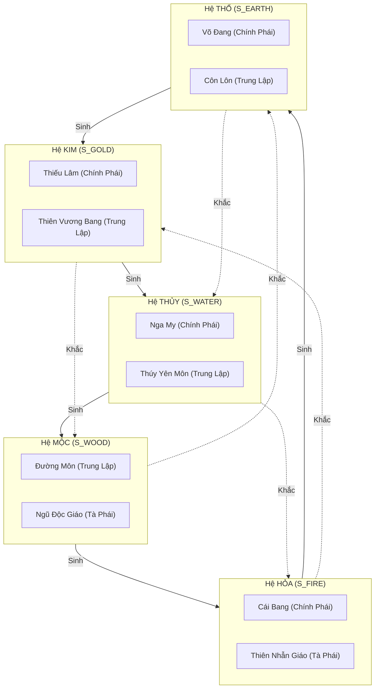

# Hệ Phái & Ngũ Hành (Factions & Five Elements)

Tài liệu này hệ thống hóa toàn bộ kiến thức về **10 Đại Môn Phái** và quy luật vận hành của **Ngũ Hành (Kim - Mộc - Thủy - Hỏa - Thổ)** trong Võ Lâm Truyền Kỳ (Sơn Hà Xã Tắc).

---

## 1. Bản Đồ Ngũ Hành & 10 Đại Môn Phái

Trong thế giới JX1, mỗi môn phái đều thuộc về một hành trong Ngũ Hành và được phân theo 3 trận doanh: **Chính Phái**, **Trung Lập**, và **Tà Phái**.

---

## 2. Quy Luật Ngũ Hành Tương Sinh & Tương Khắc

### 2.1 Quy Luật Tương Sinh
$$\text{Kim} \rightarrow \text{Thủy} \rightarrow \text{Mộc} \rightarrow \text{Hỏa} \rightarrow \text{Thổ} \rightarrow \text{Kim}$$
- **Ý nghĩa trong Game**:
  - Dùng để **Kích hoạt thuộc tính ẩn của Trang Bị**: Một trang bị hệ Thủy sẽ kích hoạt dòng ẩn thứ nhất cho trang bị hệ Kim đi kèm; trang bị hệ Mộc kích hoạt cho trang bị hệ Thủy...
  - Hỗ trợ trong tổ đội (Party): Các phái tương sinh khi đi cùng tổ đội có thể cộng hưởng các hiệu ứng hỗ trợ (Aura buff).

### 2.2 Quy Luật Tương Khắc
$$\text{Kim khắc Mộc} \rightarrow \text{Mộc khắc Thổ} \rightarrow \text{Thổ khắc Thủy} \rightarrow \text{Thủy khắc Hỏa} \rightarrow \text{Hỏa khắc Kim}$$

- **Tác Động Cực Kỳ Lớn Trong PK / Combat**:
  - **Khi đánh đối thủ bị mình khắc**: Sát thương gây ra được gia tăng từ **20% đến 40%**, đồng thời các hiệu ứng trạng thái khống chế (làm chậm, choáng, co giật) có tỷ lệ trúng và thời gian duy trì cao hơn.
  - **Khi đánh đối thủ khắc mình**: Sát thương bị suy giảm nghiêm trọng (giảm từ **20% đến 40%**), hiệu ứng khống chế dễ bị đối phương hóa giải hoặc kháng lại.
  - **Ví dụ**:
    - Võ Đang (Thổ) khắc Nga My / Thúy Yên (Thủy).
    - Đường Môn (Mộc) khắc Võ Đang / Côn Lôn (Thổ).
    - Thiếu Lâm / Thiên Vương (Kim) khắc Đường Môn / Ngũ Độc (Mộc).
    - Thiên Nhẫn / Cái Bang (Hỏa) khắc Thiếu Lâm / Thiên Vương (Kim).
    - Nga My / Thúy Yên (Thủy) khắc Thiên Nhẫn / Cái Bang (Hỏa).

---

## 3. Đặc Điểm Chi Tiết Từng Hệ Phái

| Hệ Phái | Ngũ Hành | Trận Doanh | Vũ Khí Chính | Hướng Đi / Nhánh Phái | Đặc Trưng Chiến Đấu |
| :--- | :---: | :---: | :--- | :--- | :--- |
| **Thiếu Lâm** | Kim | Chính | Đao, Côn, Quyền | Đao Thiếu, Côn Thiếu, Quyền Thiếu | Máu trâu, phản đòn sát thương cận chiến, kháng vật lý cao, chiêu khống chế Sư Tử Hống. |
| **Thiên Vương** | Kim | Trung lập | Thương, Chùy, Đao | Thương TV, Chùy TV, Đao TV | Áp sát cực mạnh, tốc đánh kinh hoàng, Đoạt Mệnh Liên Hoàn Thương, vô địch khi bật Đoạn Hồn Thích. |
| **Đường Môn** | Mộc | Trung lập | Phi Đao, Tụ Tiễn, Phi Tiêu, Cạm Bẫy | Tiêu Đường, Phi Đao, Nỏ Đường, Bẫy | Tầm xa cơ động, bẫy diện rộng, dồn sát thương bộc phát cực nhanh, chí mạng cao. |
| **Ngũ Độc** | Mộc | Tà | Đao, Chưởng | Đao Độc, Chưởng Độc, Bùa Chú | Chuyên về độc sát rút máu liên tục, thả bùa suy nhược làm suy giảm kháng tính và phòng ngự kẻ địch. |
| **Nga My** | Thủy | Chính | Kiếm, Chưởng | Kiếm Nga My, Chưởng Nga My, Buff Hỗ trợ | Băng sát làm chậm diện rộng, khả năng hồi máu, tăng tốc chạy và hỗ trợ tổ đội tốt nhất game. |
| **Thúy Yên** | Thủy | Trung lập | Đao, Song Đao | Đao Thúy Yên, Song Đao (Vũ Tiên) | Băng sát đóng băng kẻ địch, tốc độ di chuyển cao, tàng hình, chiêu Băng Tâm Tiên Tử dồn sát thương lớn. |
| **Cái Bang** | Hỏa | Chính | Chưởng, Bổng | Rồng Cái Bang (Chưởng), Bổng Cái Bang | Tầm đánh xa, sát thương rồng bay đuổi mục tiêu, độ giật cao, khả năng né tránh trác tuyệt. |
| **Thiên Nhẫn** | Hỏa | Tà | Thương (Kích), Đao, Chưởng | Kích Ma, Ma Nhẫn (Chưởng lửa), Đao Bùa | Hỏa sát thiêu đốt, gom hút mục tiêu (Thiên Ngoại Lưu Tinh), bùa chú giảm nội lực và làm suy yếu. |
| **Võ Đang** | Thổ | Chính | Kiếm, Quyền (Khí) | Kiếm Võ Đang, Khí Võ Đang | Tọa Vọng Vô Vi lấy Mana đỡ Máu (hầu như bất tử khi còn Mana), chiêu Thổ làm choáng cứng đối thủ. |
| **Côn Lôn** | Thổ | Trung lập | Đao, Kiếm | Đao Côn Lôn, Kiếm Côn Lôn, Bùa Côn Lôn | Lôi sát giật choáng cực mạnh, bùa chú tăng tốc chạy (Thanh Phong) và phản đòn, lốc xoáy Cuồng Lôi. |

---

## 4. Tương Quan Kháng Tính Khởi Đầu Của 5 Hệ
Theo cấu hình [`Client_VLTK_SHXT/settings/npc/player/level_add.txt`](../Client_VLTK_SHXT/settings/npc/player/level_add.txt):

| Hệ Ngũ Hành | Môn Phái Đại Diện | Kháng Hỏa | Kháng Băng | Kháng Độc | Kháng Lôi | Kháng Vật Lý |
| :---: | :--- | :---: | :---: | :---: | :---: | :---: |
| **Kim** | Thiếu Lâm, Thiên Vương | **-25%** | 0% | **+25%** | 0% | 0% |
| **Mộc** | Đường Môn, Ngũ Độc | 0% | 0% | 0% | **+25%** | **-15%** |
| **Thủy** | Nga My, Thúy Yên | **+25%** | 0% | 0% | **-25%** | 0% |
| **Hỏa** | Cái Bang, Thiên Nhẫn | 0% | **-25%** | 0% | 0% | **+15%** |
| **Thổ** | Võ Đang, Côn Lôn | 0% | **+25%** | **-25%** | 0% | 0% |

> [!NOTE]
> Bảng kháng tính bẩm sinh này phản ánh chính xác quy luật ngũ hành: Hệ Kim bẩm sinh sợ Hỏa (-25% Kháng Hỏa) nhưng lại kháng mạnh Mộc (+25% Kháng Độc). Người chơi cần trang bị đồ đạc để bù trừ điểm yếu bẩm sinh này.
