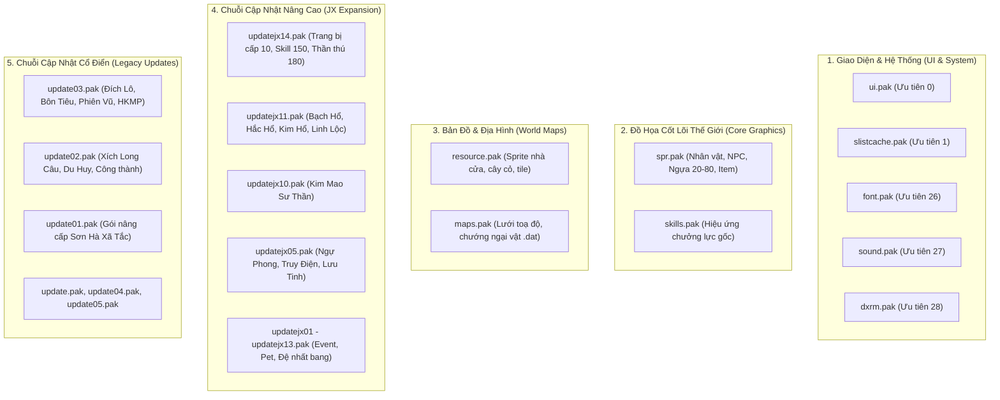

# Danh Mục & Phân Loại Toàn Bộ 29 Tệp PAK (`Client_VLTK_SHXT/data/`)

Tài liệu này thống kê, phân loại và mô tả chi tiết toàn bộ **29 tệp lưu trữ nhị phân (`.pak`)** trong thư mục [`Client_VLTK_SHXT/data/`](../Client_VLTK_SHXT/data) của client **Võ Lâm Truyền Kỳ - Sơn Hà Xã Tắc (SHXT)**.

---

## ⚡ 1. Cơ Chế Nạp & Độ Ưu Tiên (`package.ini`)

Game sử dụng cơ chế nạp đè dựa trên tệp cấu hình [`Client_VLTK_SHXT/package.ini`](../Client_VLTK_SHXT/package.ini):
- **Chỉ số nhỏ (0, 1, 2,...)**: Có độ ưu tiên **cao nhất** (Top Priority), nạp sau cùng để ghi đè (override) lên các file cũ.
- **Chỉ số lớn (23, 24, 25,...)**: Là các gói **dữ liệu gốc nền tảng** (Base Data).
- **Tổng dung lượng**: **~4,562.16 MB** (~4.46 GB).
- **Tổng số tệp con bên trong**: **166,650 tệp** (được băm bằng hàm `g_HashString2Id` và nén bằng thuật toán UCL NRV2B).

---

## 📊 2. Bảng Tra Cứu Toàn Diện 29 Tệp PAK

Bảng dưới đây được sắp xếp theo đúng **Thứ tự ưu tiên nạp từ cao xuống thấp** (từ `0` đến `28`):

| Độ Ưu Tiên | Tên Tệp PAK | Dung Lượng (MB) | Dung Lượng (Bytes) | Số Tệp Con | Vai Trò & Nội Dung Chi Tiết |
| :---: | :--- | :---: | :---: | :---: | :--- |
| **0** | [`ui.pak`](../Client_VLTK_SHXT/data/ui.pak) | **253.89 MB** | 266,227,847 B | 3,381 | **Giao diện người dùng (Top Priority)**: File cấu hình toạ độ `.ini` các cửa sổ (F3, F4, F5, Bang hội, Đăng nhập), khung viền cửa sổ, nút bấm button 4 trạng thái, icon kỹ năng/vật phẩm, thanh máu mana, biểu cảm chat, ảnh nền đăng nhập `.png`/`.jpg`. |
| **1** | [`slistcache.pak`](../Client_VLTK_SHXT/data/slistcache.pak) | **9.19 MB** | 9,641,045 B | 469 | **Bộ đệm cấu hình & máy chủ**: Chứa danh sách server (Server List Cache), dữ liệu cấu hình đệm (settings/scripts cache), thiết lập bẫy cạm bẫy (trap logic) và thông số mạng. |
| **2** | [`updatejx14.pak`](../Client_VLTK_SHXT/data/updatejx14.pak) | **1,611.25 MB** | 1,689,516,963 B | 19,502 | **Bản cập nhật đồ họa lớn nhất (JX1 Expanded)**: Chứa trọn bộ trang phục Cấp 10, vũ khí phát sáng hoàng kim, kỹ năng 120-150, Thần thú Cấp 180 (*Bích Thủy Thần Câu, Tử Long Chiến Mã, Hỏa Diệm Chiến Mã, Hàn Băng Thần Mã*) và hiệu ứng vòng sáng chân/vũ khí (aura). |
| **3** | [`updatejx13.pak`](../Client_VLTK_SHXT/data/updatejx13.pak) | **260.27 MB** | 272,909,337 B | 4,317 | **Cập nhật tính năng Bang hội & Hoạt động**: Bổ sung trang bị ngoại trang mới, hoạt ảnh sự kiện lễ hội, bản đồ liên đấu và vật phẩm hoạt động bang hội. |
| **4** | [`updatejx12.pak`](../Client_VLTK_SHXT/data/updatejx12.pak) | **55.21 MB** | 57,891,722 B | 264 | **Bản vá hoạt ảnh & kỹ năng bổ sung**: Bổ sung một số hiệu ứng chiêu thức và động tác mở rộng của các phái. |
| **5** | [`updatejx11.pak`](../Client_VLTK_SHXT/data/updatejx11.pak) | **46.44 MB** | 48,692,459 B | 1,954 | **Cập nhật Thần Thú Cấp 180**: Chứa bộ sprite chuyển động và tư thế cưỡi của 4 thần thú: *Kim Tinh Bạch Hổ, Long Tinh Hắc Hổ, Hỏa Tinh Kim Hổ, Thần Thú Linh Lộc*. |
| **6** | [`updatejx10.pak`](../Client_VLTK_SHXT/data/updatejx10.pak) | **82.26 MB** | 86,252,479 B | 2,054 | **Cập nhật Thần Thú Sư Tử & Phụ bản**: Chứa thần thú *Kim Mao Sư Thần (Cấp 180)*, phụ bản vượt ải mới và một số trang phục hoàng kim. |
| **7** | [`updatejx09.pak`](../Client_VLTK_SHXT/data/updatejx09.pak) | **80.68 MB** | 84,602,250 B | 3,062 | **Cập nhật Hệ thống Bạn đồng hành (Partner/Pet)**: Tài nguyên hiển thị cho thú cưng, bạn đồng hành, danh hiệu mới và chuỗi nhiệm vụ Dã Tẩu mở rộng. |
| **8** | [`updatejx08.pak`](../Client_VLTK_SHXT/data/updatejx08.pak) | **79.14 MB** | 82,985,044 B | 1,752 | **Cập nhật Hiệu ứng chiêu thức & Cân bằng môn phái**: Cập nhật lại một số sprite đường đạn, hiệu ứng trúng đòn ngũ hành và giao diện hỗ trợ. |
| **9** | [`updatejx07_jxf06.pak`](../Client_VLTK_SHXT/data/updatejx07_jxf06.pak) | **135.25 MB** | 141,819,039 B | 1,036 | **Cập nhật Giải đấu Thiên Hạ Đệ Nhất Bang (JXF06)**: Bản đồ chiến trường Tống Kim mở rộng, cờ hiệu, trang bị thi đấu đặc biệt và các danh hiệu quán quân liên đấu. |
| **10** | [`updatejx06.pak`](../Client_VLTK_SHXT/data/updatejx06.pak) | **42.09 MB** | 44,139,762 B | 2,669 | **Cập nhật Võ Lâm Liên Đấu & Danh hiệu**: Đồ họa vòng sáng vinh danh liên đấu, các bộ trang bị thưởng và biểu tượng danh hiệu. |
| **11** | [`updatejx05.pak`](../Client_VLTK_SHXT/data/updatejx05.pak) | **127.98 MB** | 134,192,324 B | 2,678 | **Cập nhật Bộ Tam Thần Mã Cấp 150 & Phi Phong**: Chứa 3 chiến mã huyền thoại: *Ngự Phong, Truy Điện, Lưu Tinh*; bổ sung hệ thống Áo Choàng (Phi Phong) và Quan Ấn. |
| **12** | [`updatejx04.pak`](../Client_VLTK_SHXT/data/updatejx04.pak) | **83.22 MB** | 87,263,802 B | 992 | **Cập nhật Vũ khí đặc biệt & Hiệu ứng âm thanh**: Bổ sung sprite vũ khí Song Binh (song đao, song chùy động tác `at06`), hiệu chỉnh âm thanh binh khí. |
| **13** | [`updatejx03.pak`](../Client_VLTK_SHXT/data/updatejx03.pak) | **59.49 MB** | 62,380,623 B | 5,363 | **Cập nhật NPC & Sự kiện mùa lễ hội**: Bổ sung hàng loạt sprite NPC nhiệm vụ mới, quái vật sự kiện Tết/Trung Thu và vật phẩm tiêu hao. |
| **14** | [`updatejx02.pak`](../Client_VLTK_SHXT/data/updatejx02.pak) | **85.76 MB** | 89,924,772 B | 551 | **Cập nhật Kỹ năng cấp cao & Trang bị Tím**: Khởi đầu hệ thống chiêu thức cấp 120, trang bị tím (huyền tinh hút hít) và các hiệu ứng phát quang. |
| **15** | [`updatejx01.pak`](../Client_VLTK_SHXT/data/updatejx01.pak) | **89.16 MB** | 93,491,278 B | 63 | **Gói nền tảng chuỗi cập nhật JX**: Chứa các tệp thư viện đồ họa cốt lõi, nâng cấp engine hiển thị của Kingsoft. |
| **16** | [`update05.pak`](../Client_VLTK_SHXT/data/update05.pak) | **0.01 MB** | 9,491 B | 11 | **Bản vá lỗi khẩn cấp (Hotfix)**: Tệp dung lượng nhỏ nhất, sửa chữa nhanh một số lỗi chỉ số cấu hình và sprite hiển thị sai. |
| **17** | [`update04.pak`](../Client_VLTK_SHXT/data/update04.pak) | **32.01 MB** | 33,566,226 B | 1,703 | **Bản vá nhiệm vụ & địa hình**: Sửa đổi toạ độ va chạm một số bản đồ, bổ sung NPC nhiệm vụ môn phái xuất sư. |
| **18** | [`update03.pak`](../Client_VLTK_SHXT/data/update03.pak) | **78.17 MB** | 81,963,107 B | 10,010 | **Cập nhật Danh Mã & Hoàng Kim Môn Phái**: Chứa chiến mã Cấp 80 *Đích Lô*, Thần mã Cấp 120 *Bôn Tiêu*, Đệ nhất danh mã Cấp 150 *Phiên Vũ*; trọn bộ trang bị Hoàng Kim Môn Phái. |
| **19** | [`update02.pak`](../Client_VLTK_SHXT/data/update02.pak) | **45.04 MB** | 47,227,764 B | 515 | **Cập nhật Thú Cưỡi Cấp 130 & Công Thành Chiến**: Chứa 2 chiến mã *Xích Long Câu, Du Huy*; tài nguyên bản đồ và công trình thành trì Công Thành Chiến (Thất Đại Thành Thị). |
| **20** | [`update01.pak`](../Client_VLTK_SHXT/data/update01.pak) | **141.70 MB** | 148,588,363 B | 17,609 | **Bản cập nhật lớn thời kỳ đầu (SHXT Edition)**: Nâng cấp tổng thể từ phiên bản Công Thành Chiến lên Sơn Hà Xã Tắc; bổ sung hàng loạt bản đồ mới, quái vật và nhiệm vụ chính tuyến. |
| **21** | [`update.pak`](../Client_VLTK_SHXT/data/update.pak) | **86.63 MB** | 90,836,874 B | 4,017 | **Bản vá tổng hợp cơ sở**: Gói tích lũy các bản sửa lỗi đồ họa và dữ liệu giữa phiên bản Alpha/Beta và bản chính thức ban đầu. |
| **22** | [`skills.pak`](../Client_VLTK_SHXT/data/skills.pak) | **37.82 MB** | 39,654,872 B | 257 | **Hiệu ứng chiêu thức võ công gốc**: Chứa các sprite `.spr` đường đạn (missile), hiệu ứng chưởng lực bay, vòng xoáy nổ và hào quang hỗ trợ của 10 đại môn phái thời kỳ đầu. |
| **23** | [`spr.pak`](../Client_VLTK_SHXT/data/spr.pak) | **704.28 MB** | 738,486,991 B | 14,616 | **Kho Sprite Thế Giới Cốt Lõi (Core Sprites)**: Chứa toàn bộ nhân vật Nam/Nữ ghép đa lớp (thân, đầu, tay, vũ khí, tóc), trọn bộ Chiến mã Cấp 20-80, quái vật dã ngoại, NPC dân làng, vật phẩm rơi trên đất (`\spr\item\`) và vật thể động trên bản đồ (`\spr\obj\`). |
| **24** | [`resource.pak`](../Client_VLTK_SHXT/data/resource.pak) | **227.23 MB** | 238,266,129 B | 2,810 | **Tài nguyên địa hình & Kiến trúc (Map Tiles)**: Chứa toàn bộ sprite `.spr` tĩnh dựng bản đồ Isometric: nền đất, cây cối, bờ sông, tường thành, mái nhà ngói, gạch đá phục vụ cho Engine dựng map. |
| **25** | [`maps.pak`](../Client_VLTK_SHXT/data/maps.pak) | **87.53 MB** | 91,776,706 B | 64,569 | **Dữ liệu cấu trúc bản đồ thế giới (Map Cells/Regions)**: Tệp có số lượng file con lớn nhất (hơn 64k files `.dat`), lưu trữ thông tin chỉ mục tile nền, chướng ngại vật (Obstacle), toạ độ lưới Isometric ($64 \times 32$) và điểm chuyển dịch (traps). |
| **26** | [`font.pak`](../Client_VLTK_SHXT/data/font.pak) | **2.17 MB** | 2,277,233 B | 6 | **Font chữ đồ họa hệ thống**: Chứa 6 tệp phông chữ đặc thù của Kingsoft (định dạng Bitmap Font `.asf`) hỗ trợ hiển thị văn bản tiếng Hoa và tiếng Việt bảng mã TCVN3/GBK. |
| **27** | [`sound.pak`](../Client_VLTK_SHXT/data/sound.pak) | **17.99 MB** | 18,868,355 B | 416 | **Âm thanh hiệu ứng (Sound Effects - SFX)**: Toàn bộ âm thanh nhị phân WAV/RIFF: tiếng va chạm binh khí (kiếm, thương, đao, chùy), tiếng ngựa hí cước bộ phi nhanh, tiếng niệm chú, tiếng chưởng nổ và tiếng bước chân. |
| **28** | [`dxrm.pak`](../Client_VLTK_SHXT/data/dxrm.pak) | **0.31 MB** | 321,330 B | 4 | **DirectX Render Material**: Chứa các tệp mô tả chất liệu và cấu hình đồ họa cấp thấp của engine kết xuất DirectX (DirectDraw/Direct3D wrapper). |

---

## 🗂️ 3. Phân Nhóm Chức Năng Của Các Gói PAK

Để tiện tra cứu và phát triển công cụ (tooling/scripts), có thể phân loại 29 tệp trên thành **5 nhóm chức năng chính**:

### 1. Nhóm Giao Diện & Hệ Thống
- **Đại diện**: `ui.pak`, `slistcache.pak`, `font.pak`, `sound.pak`, `dxrm.pak`.
- **Đặc điểm**: Đảm nhiệm tương tác ngoài game và giao diện trong game. `ui.pak` luôn giữ vị trí ưu tiên `0` để bất kỳ sửa đổi giao diện nào cũng được áp dụng ngay lập tức.

### 2. Nhóm Đồ Họa Cốt Lõi Thế Giới (In-game Sprites)
- **Đại diện**: `spr.pak`, `skills.pak`.
- **Đặc điểm**: Cung cấp khung xương đồ họa cơ bản của toàn bộ trò chơi (mô hình nhân vật đa lớp, hoạt ảnh 8 hướng, vũ khí cơ bản, hiệu ứng chiêu thức).

### 3. Nhóm Bản Đồ & Địa Hình (Map Engine)
- **Đại diện**: `resource.pak` (chứa hình ảnh tile `.spr`) và `maps.pak` (chứa dữ liệu nhị phân không gian `.dat`).
- **Đặc điểm**: Hai gói này phối hợp chặt chẽ: `maps.pak` cung cấp khung lưới toạ độ, cell và chướng ngại vật; `resource.pak` cung cấp hình ảnh tile vẽ lên lưới đó.

### 4. Nhóm Cập Nhật Nâng Cao (JX Series: `updatejx01.pak` $\rightarrow$ `updatejx14.pak`)
- **Đặc điểm**: Đại diện cho sự phát triển của game qua các phiên bản Kiếm Hiệp Tình Duyên mở rộng. Đáng chú ý nhất là `updatejx14.pak` với dung lượng khổng lồ (~1.61 GB), chiếm hơn 35% dung lượng toàn bộ thư mục `data/`.

### 5. Nhóm Cập Nhật Cổ Điển (Classic Updates: `update.pak`, `update01.pak` $\rightarrow$ `update05.pak`)
- **Đặc điểm**: Cung cấp các tính năng bước ngoặt thời kỳ đầu: Thú cưỡi cao cấp (Đích Lô, Bôn Tiêu, Phiên Vũ), Trang bị Hoàng Kim Môn Phái và Chiến trường Tống Kim.

---

## 🛠️ 4. Lưu Ý Kỹ Thuật Khi Trích Xuất & Modding

1. **Thứ tự quét gói (Reverse Priority Scanning)**:
   - Khi viết tool tìm file theo đường dẫn (ví dụ: `\spr\npcres\horse\039_ha01.spr`), phải quét mảng PAK theo thứ tự **từ `updatejx14.pak` ngược xuống `spr.pak`**.
2. **Thuật toán giải mã**:
   - Tên file không được lưu trực tiếp dạng plaintext trong PAK mà chỉ lưu mã hash 32-bit (`g_HashString2Id`).
   - Khối dữ liệu nén trong PAK sử dụng thuật toán **UCL NRV2B** của Kingsoft (xem chi tiết tại [`docs/file_formats_pak_spr.md`](file_formats_pak_spr.md)).
3. **Bộ công cụ có sẵn**:
   - Giải nén từng gói PAK: [`scripts/unpack_pak.py`](../scripts/unpack_pak.py).
   - Quét nhanh bằng C dylib: [`scripts/fast_scanner.c`](../scripts/fast_scanner.c).
   - Trích xuất ngựa toàn diện: [`scripts/export_extended_horses.py`](../scripts/export_extended_horses.py).

