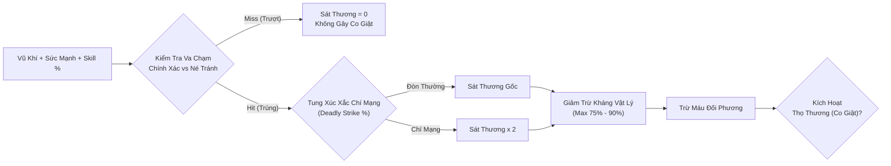

# Chuyên Đề: Sát Thương Vật Lý & Hiệu Ứng Co Giật (Thọ Thương / HurtFrame)

> **Mục đích tài liệu**: Tài liệu này phân tích chi tiết cơ chế toán học, chu kỳ khung hình (frame cycle) của **Sát thương vật lý (Physical Damage)**, bản chất của **Hiệu ứng co giật (Thọ thương / Stagger / Hit Recovery)**, và các giải pháp phòng tránh thông qua cơ chế **Thời gian phục hồi -% (Fast Hit Recovery)** trong Võ Lâm Truyền Kỳ (JX1 / VLTK).  
> **Dữ liệu tham chiếu**: Trích xuất trực tiếp từ mã nguồn engine game [`Client_VLTK_SHXT/settings/npc/player/basevalue.ini`](../Client_VLTK_SHXT/settings/npc/player/basevalue.ini), [`Client_VLTK_SHXT/settings/item/000/magicattrib.txt`](../Client_VLTK_SHXT/settings/item/000/magicattrib.txt), và [`Client_VLTK_SHXT/settings/item/000/goldequip.txt`](../Client_VLTK_SHXT/settings/item/000/goldequip.txt).

---

## 1. Bản Chất & Cách Tính Sát Thương Vật Lý (Physical Damage)

Sát thương vật lý (STVL) là loại sát thương nền tảng và phổ biến nhất của các môn phái ngoại công (Thiên Vương, Thiếu Lâm Đao/Côn, Đường Môn Phi Đao/Nỏ, Võ Đang Kiếm, Thúy Yên Đao, Cái Bang Bổng).



### 1.1 Công Thức Tính Sát Thương Vật Lý Xuất Ra (Lực tay F3)
$$\text{Damage Vật Lý} = (W + B) \times \left(1 + \frac{P_{\text{str}}}{100}\right) \times \left(1 + \frac{S_{\text{passive}} + S_{\text{active}} + S_{\text{synergy}} + S_{\text{gear}}}{100}\right)$$

- $W$: Sát thương vật lý cơ bản của vũ khí (ví dụ Đao Cấp 10: $40 - 114$).
- $B$: Điểm STVL cộng thêm từ trang bị (bao tay, nhẫn, dây chuyền: $+20 \sim 50$ điểm).
- $P_{\text{str}}$: Điểm Sức mạnh của nhân vật (mỗi 100 điểm tăng gấp đôi sát thương cơ bản).
- $S$: Tổng phần trăm tăng sát thương từ chiêu thức cơ bản, chiêu thức chủ động và trang bị.

### 1.2 Bước Kiểm Tra Va Chạm: Chính Xác (Attack Rating) vs Né Tránh (Defense)
Khác với sát thương nội công luôn trúng mục tiêu khi chạm đạn, **Sát thương vật lý bắt buộc phải tính tỷ lệ đánh trúng**:

$$\text{Tỉ Lệ Đánh Trúng (Hit Rate)} = \frac{2 \times \text{AR}}{\text{AR} + \text{Defense}} \times 100\%$$

- **Nếu Trượt (`Miss`)**: Không gây bất kỳ sát thương nào và **hoàn toàn không kích hoạt hiệu ứng co giật**.
- **Nếu Trúng (`Hit`)**: Sát thương sẽ được tính tiếp qua giảm trừ phòng thủ và kiểm tra trạng thái thọ thương.

### 1.3 Giảm Trừ Qua Kháng Vật Lý (Physics Resist)
$$\text{Damage Thực Nhận Vào Máu} = \text{Damage Vật Lý Đánh Ra} \times \left(1 - \frac{\text{Kháng Vật Lý \%}}{100}\right)$$

- Trần kháng vật lý cơ bản: **$75\%$**.
- Với trang bị Hoàng Kim / An Bang / Kỹ năng hộ thể (như Kim Chung Trạo): Trần kháng có thể nâng lên **$85\% - 90\%$**.

---

## 2. Hiệu Ứng Co Giật (Thọ Thương / HurtFrame) Là Gì?

### 2.1 Định Nghĩa Kỹ Thuật
Trong engine Kingsoft JX1, hiệu ứng co giật có tên mã là **`HurtFrame`** (Hành động bị thương - 受伤动作). Khi nhân vật nhận một đòn sát thương vật lý trúng đích vượt qua một ngưỡng quy định, nhân vật sẽ bị ngắt ngang hành động hiện tại và buộc phải thực hiện chuỗi hoạt ảnh nảy người / giật giật về phía sau.

### 2.2 Thời Gian Hiệu Lực Của Co Giật Mặc Định
Trích xuất từ tệp cấu hình cốt lõi [`Client_VLTK_SHXT/settings/npc/player/basevalue.ini`](../Client_VLTK_SHXT/settings/npc/player/basevalue.ini):

```ini
[Common]
HurtFrame=12
RunSpeed=10
WalkSpeed=5
AttackFrame=18
CastFrame=18
```

- **Số frame thọ thương mặc định**: `HurtFrame = 12 frames`.
- **Tốc độ khung hình của game**: Game VLTK vận hành ở tốc độ **$18\text{ frames/giây}$** ($1\text{ frame} \approx 0.0556\text{ giây} \approx 55.6\text{ ms}$).
- **Thời gian co giật thực tế**:
  $$\text{Thời Gian Co Giật Mặc Định} = \frac{12\text{ frames}}{18\text{ frames/s}} = \mathbf{\frac{2}{3}\text{ giây} \approx 0.67\text{ giây}}$$

### 2.3 Hậu Quả Chí Mạng Trong Thực Chiến PK
Trong suốt **$0.67\text{ giây}$** co giật này, nhân vật bị khóa hoàn toàn trạng thái điều khiển:
1. **Bị Khựng Bất Động**: Không thể bước đi hay khinh công nhảy ra khỏi tầm đánh.
2. **Bị Ngắt Chiêu (Skill Interruption)**: Nếu đang chuẩn bị xuất chiêu hoặc tụ khí, động tác tấn công bị hủy bỏ ngay lập tức.
3. **Hoãn Bơm Máu**: Thao tác cắn bình Ngũ Hoa Ngọc Lộ Hoàn hoặc Cửu Chuyển Hoàn Hồn Đan bị trễ nhịp (bình máu không phát huy tác dụng kịp lúc).

### 2.4 Cơn Ác Mộng "Khựng Liên Hoàn" (Stun-Lock / Hurt-Lock)
Nếu đối phương sở hữu tốc độ xuất chiêu cao hơn thời gian phục hồi của bạn:
- Ví dụ: Một đòn đâm của Thiên Vương Thương hay đòn ném phi đao của Đường Môn có chu kỳ chỉ từ **$8 - 10\text{ frames}$** ($0.44 - 0.55\text{ giây}$).
- Trong khi nhân vật của bạn cần tới **$12\text{ frames}$** ($0.67\text{ giây}$) mới hồi phục sau một nhát chém.
- **Hậu quả**: Khi bạn chưa kịp hết động tác co giật của đòn thứ nhất, đòn thứ hai và thứ ba đã giáng xuống. Bạn rơi vào trạng thái **"Đứng hình liên tục cho đến chết" (Hurt-lock)** mà không thể bấm về thành (Phù) hay bơm máu!

---

## 3. Cách Phòng Tránh: Cơ Chế Mặc Đồ "Thời Gian Phục Hồi -%"

Để phá vỡ vòng lặp thọ thương chết người này, trang bị trong game cung cấp một thuộc tính phòng thủ tối quan trọng: **Thời gian phục hồi -%** (Fast Hit Recovery / Đả Kích Hồi Phục).

### 3.1 Mã Thuộc Tính Trong Engine
- **ID Ma Pháp Trong File Item**: `MagicAttrib ID = 113` (trong `magicattrib.txt`).
- **Mã Kỹ Thuật**: `fasthitrecover_v` / `hitrecover_reduce` (Tiếng Trung: 打击回复 / 快速受伤动作).
- **Ý nghĩa**: Giảm trực tiếp phần trăm thời gian hoạt ảnh `HurtFrame`.

### 3.2 Công Thức Tính Số Frame Co Giật Thực Tế
$$\text{Số Frame Co Giật Còn Lại} = \left\lfloor \text{HurtFrame Mặc Định (12)} \times \left(1 - \frac{\text{Tổng Thời Gian Phục Hồi \%}}{100}\right) \right\rfloor$$

### 3.3 Bảng Mốc Frame (Breakpoints) & Thời Gian Phục Hồi Chi Tiết

| Mức Thời Gian Phục Hồi | Số Frame Thọ Thương Thực Tế | Thời Gian Co Giật (Giây) | Mức Độ An Toàn Trong Thực Chiến |
| :---: | :---: | :---: | :--- |
| **$0\%$ (Không Mặc Đồ)** | **$12\text{ frames}$** | **$0.67\text{s}$** | 🔴 **Cực kỳ nguy hiểm**: Dễ dàng bị dồn giật chết đứng hình. |
| **$-20\%$** | **$9 - 10\text{ frames}$** | **$0.53\text{s}$** | 🟠 **Yếu**: Vẫn bị khựng rõ rệt trước các phái tốc đánh cao. |
| **$-30\%$** | **$8\text{ frames}$** | **$0.44\text{s}$** | 🟡 **Khá**: Giảm được 1/3 thời gian co giật, bắt đầu có thể nhấp chuột chạy thoát. |
| **$-40\%$ (1 Áo Chuẩn)** | **$7\text{ frames}$** | **$0.39\text{s}$** | 🟢 **Mức Chuẩn Bắt Buộc**: Đạt được khi mặc 1 chiếc Áo Giáp có dòng phục hồi $-40\%$. |
| **$-60\%$** *(Áo + Giày/Nón)* | **$5\text{ frames}$** | **$0.28\text{s}$** | 🔵 **Rất Tốt**: Thời gian khựng chỉ còn chớp mắt, thoát khỏi hầu hết các chuỗi combo. |
| **$-70\% \sim -80\%$** *(Hoàng Kim/Định Quốc)* | **$3 - 4\text{ frames}$** | **$0.17\text{s} - 0.22\text{s}$** | 🟣 **Cực Hạn Bất Khả Xâm Phạm**: Khựng gần như bằng 0, nhân vật có thể vừa chịu đòn vừa lướt đi mượt mà. |

---

## 4. Danh Mục Trang Bị Sở Hữu Dòng "Thời Gian Phục Hồi -%"

Trích xuất từ tệp `magicattrib.txt` và `goldequip.txt`, thuộc tính `113` xuất hiện độc quyền hoặc ưu tiên trên các vị trí trang bị sau:

### 4.1 Áo Giáp (Vị Trí Cốt Lõi Số 1)
Áo Giáp là trang bị bắt buộc phải có dòng Thời gian phục hồi của mọi người chơi PK chuyên nghiệp:
- **Áo Xanh Cấp 10**: Thường có các dòng:
  - *Ngày bình thường*: Thời gian phục hồi **$-20\%$**
  - *Định mệnh*: Thời gian phục hồi **$-30\%$**
  - *Cảm xúc*: Thời gian phục hồi **$-40\%$** (Áo chuẩn quốc dân)
- **Áo Hoàng Kim Môn Phái**: Toàn bộ áo Hoàng Kim các phái đều được Kingsoft trang bị sẵn dòng Thời gian phục hồi cực mạnh (dòng ma pháp 39: **$-40\%$**):
  - *Hám Thiên Chiến Giáp* (Thiên Vương Chùy)
  - *Ngự Long Chiến Giáp* (Thiên Vương Đao)
  - *Kế Nghiệp Chiến Giáp* (Thiên Vương Thương)
  - *Phục Ma Giới Sam* (Thiếu Lâm Côn)
  - *Tứ Không Giới Sam* (Thiếu Lâm Đao)
  - *Vô Ma Truy Y* (Nga My)
  - *Vô Gian Truy Y* (Thúy Yên)
  - *Định Quốc Thanh Sa Trường Bào / Chiến Bào* (Set Định Quốc)

### 4.2 Các Vị Trí Khác Bổ Trợ Đẩy Lên Mốc Cực Hạn ($-60\% \rightarrow -80\%$)
- **Nón**: *Vô Hoàn Kinh Quán* (Nón Hoàng Kim môn phái), Nón chế tác đồ tím.
- **Giày**: *Bích Hải Hồng Lăng Ba*, *Vũ Trăn Nhuệ Lữ* (dòng ma pháp 38: $-30\% \sim -40\%$).
- **Bộ Trang Bị Định Quốc & An Bang**: Hiệu ứng kích hoạt theo set giúp nhân vật dễ dàng chạm ngưỡng $-70\% \sim -80\%$.

---

## 5. Mối Quan Hệ Giữa Co Giật & Thuộc Tính Kỹ Năng "Tăng Thời Gian Thọ Thương" (`anti_hitrecover`)

Một số môn phái cận chiến hàng đầu sở hữu kỹ năng nội tại hoặc trấn phái mang thuộc tính **`anti_hitrecover`** (Gia tăng thời gian thọ thương của kẻ địch):

- **Thiên Vương Chiến Ý (`tianwang_zhanyi`)**:
  ```lua
  anti_hitrecover = {{{1,1},{50,50},{51,50}}} -- Tăng thời gian thọ thương của địch lên tới +25 frames!
  ```
- **Thiếu Lâm Đao / Dịch Cân Kinh**: Cũng sở hữu các thuộc tính kéo dài thời gian khựng của mục tiêu.

> [!WARNING]
> Khi đối đầu với Thiên Vương hoặc Thiếu Lâm Đao có `anti_hitrecover`, thời gian co giật của bạn có thể bị kéo dài từ $12\text{ frames}$ lên tới **$18 - 25\text{ frames}$** (hơn $1 - 1.4\text{ giây}$ co giật)!  
> Nếu bạn **không mặc áo phục hồi $-40\%$**, bạn chắc chắn sẽ bị đâm/chém đến chết mà không bao giờ cử động lại được.

---

## 6. Tổng Kết Quy Tắc Trang Bị Phòng Ngự Chuẩn

```text
Quy Tắc Sống Còn Trong PK Võ Lâm Truyền Kỳ:
1. Mức Tối Thiểu: Luôn luôn phải mặc 1 chiếc Áo Giáp có dòng Thời Gian Phục Hồi -40% (Đưa HurtFrame từ 12 xuống 7 frames).
2. Mức Nâng Cao: Kết hợp thêm 1 món Nón/Giày có dòng Phục Hồi -20% đến -30% (Đưa tổng phục hồi lên -60% -> 5 frames).
3. Mức Hoàn Hảo: Đạt ngưỡng -70% -> -80% với đồ Hoàng Kim / Định Quốc (HurtFrame chỉ còn 3 - 4 frames, hoàn toàn miễn nhiễm với Stun-lock).
```


---
